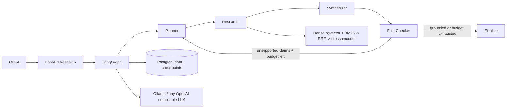

# OmniAgent

Autonomous multi-agent RAG platform: **LangGraph** orchestration with a **bounded
cyclical reflection loop**, **hybrid retrieval** (pgvector dense + BM25 + RRF fusion +
cross-encoder rerank), and a **measured evaluation suite** (retrieval ablation + RAG
Triad). Runs fully self-hosted on a single 8 GB / 2 vCPU box with no GPU and no
external LLM APIs.

## What it is

- **Stateful multi-agent graph** (LangGraph): Query Planner -> Research Agent ->
  Synthesizer -> Fact-Checker -> Finalize, with a conditional edge that loops back to
  the Planner when claims fail verification (reflection budget: `MAX_REFLECTIONS`).
- **Hybrid retrieval**: dense (pgvector + BGE) and sparse (BM25) legs fused by
  Reciprocal Rank Fusion, then reranked by a cross-encoder. Every stage is
  toggleable per request for ablation.
- **Groundedness guardrails**: the Synthesizer refuses on thin evidence instead of
  guessing; the Fact-Checker verdicts are fail-closed (unparseable output is treated
  as unsupported, never as a silent pass).
- **Idempotent ingestion** (LlamaIndex readers + splitter + BGE embeddings):
  chunk content is SHA-256 hashed; re-ingesting an unchanged corpus is a no-op.
- **SSE streaming**: `POST /api/v1/research/stream` emits one `node` event per
  graph step (subqueries, evidence, draft preview, verdict summary -- every
  reflection round visible as it happens), then `result` with the full response
  contract, then `done`.
- **Evaluation, not vibes**: a golden set with labels (including unanswerable
  questions) drives a retrieval ablation (recall@5, MRR, p50 latency per arm) and an
  LLM-judged RAG Triad (context relevance, groundedness, answer relevance +
  refusal accuracy). Reports land in `evals/results/`.

## Verified on this deployment

Host: Ubuntu 24.04, 2 vCPU AMD EPYC, 7.8 GB RAM, no GPU. All models run locally
(Ollama `llama3.2:3b`, BGE-small embeddings, MiniLM cross-encoder).

- End-to-end query (BM25 parameters question): planner produced 2 subqueries, 5
  evidence chunks retrieved through the full hybrid path, answer fully grounded
  (k1 = 1.2 useful range 1.2-2.0, b = 0.75), **7/7 claims supported**, 0 reflections,
  full node trace returned.
- Ingestion idempotency: second run over the same corpus created **0 chunks,
  skipped all**; adding 12 new docs created exactly 12 and skipped the 12 existing.
- Live HTTP run (same box, Ollama llama3.2:3b): `POST /api/v1/research` returned
  200 in 159 s with 5 citations, 4 claim verdicts, 1 flagged claim and
  **2 reflection rounds** (MAX_REFLECTIONS budget exhausted -> finalize with the
  claim honestly flagged, not silently retried); `/metrics` recorded the per-node
  LLM calls and the reflection counter.
- SSE live run: `POST /api/v1/research/stream` streamed 13 `node` events with
  both reflection rounds visible in real time (evidence accumulating 6 -> 7
  across rounds), then `result` (7 citations, 18 claim verdicts, 2 reflections,
  290 s wall -- dominated by three full plan/synthesize/verify rounds on the
  CPU 3B model) and `done`.
- Ingestion convergence live test: edit + delete + add re-ingest returned
  {created 2, skipped 1, chunks_deleted 1, documents_removed 1}; the following
  run was a pure no-op. The index converges to the directory state.
- Unit tests: **21 passed** (RRF math, BM25, config, reflection feedback, tolerant
  JSON parsing, fake-LLM graph behavior incl. reflection termination and refusal);
  `ruff check` clean.
- Retrieval ablation on the 24-doc corpus (12 golden queries, top-8):

| arm | recall@5 | MRR | p50 latency |
|---|---|---|---|
| dense | 1.000 | 1.000 | 27.0 ms |
| dense + bm25 (RRF) | 1.000 | 0.958 | 24.2 ms |
| dense + bm25 + rerank | 1.000 | 1.000 | 412.7 ms |

Honest read (see `docs/EVALUATION.md`): on a 24-doc corpus of topically distinct
documents, dense retrieval is at ceiling, so hybrid fusion adds no recall; the RRF
reshuffle costs MRR, and the cross-encoder restores it at +388 ms. Hybrid recall
gains require a larger corpus with adversarial distractors -- the harness to show
that is the point. The latest RAG Triad report is in `evals/results/`.

## Quickstart

```bash
cp .env.example .env         # set DB_PASSWORD; everything else has sane defaults
make install                 # pip install -e ".[dev]"
make db-up                    # Postgres 16 + pgvector on loopback only
make migrate                  # alembic upgrade head
make seed                     # idempotent ingest of data/sample_corpus
make run                      # uvicorn on localhost:8000
```

```bash
curl -s http://localhost:8000/health
curl -s -X POST http://localhost:8000/api/v1/research \
  -H 'Content-Type: application/json' \
  -d '{"query": "What do the BM25 parameters k1 and b control?"}' | python3 -m json.tool
# SSE: node events stream live, full result at the end
curl -N -X POST http://localhost:8000/api/v1/research/stream \
  -H 'Content-Type: application/json' \
  -d '{"query": "What is continuous batching?"}'
make ablation                 # retrieval ablation -> evals/results/
.venv/bin/python -m app.eval.runner --mode triad   # RAG Triad (needs the LLM backend)
make test                     # 19 unit tests, no backend required
```

Postman: import `postman/OmniAgent.postman_collection.json` (+ the environment
file) for every endpoint, including a refusal-demo request and response tests.

## Architecture (short version)



Full design: `docs/ARCHITECTURE.md` (HLD) and `docs/LLD.md` (LLD). Decisions are
recorded as ADRs in `docs/adr/`. Security posture: `docs/SECURITY.md`. Removing
everything this project installed on the host: `docs/TEARDOWN.md`.

## Repo layout

```text
app/
  core/        config (.env via pydantic-settings), structlog logging
  db/          SQLAlchemy async models + sessions, Alembic ownership
  llm/         first-party OpenAI-compatible client: retries, role routing, JSON
  ingestion/   LlamaIndex readers/splitter + BGE embedder, idempotent pipeline
  retrieval/   dense, sparse (BM25), RRF, cross-encoder, toggleable pipeline
  agents/      LangGraph state, nodes, graph, Postgres checkpointer
  api/         FastAPI app, v1 routes, optional API-key middleware
  observability/  Prometheus metrics emitted from the graph trace
  eval/        ablation + RAG Triad runner, report writer
alembic/       migrations (documents, chunks + vector, ingestion_jobs)
data/sample_corpus/  24 technical docs (12 target + 12 distractors)
evals/golden/  14 labelled queries incl. 2 unanswerable
evals/results/ measured reports (JSON + Markdown)
tests/         19 backend-free unit tests
postman/      importable Postman collection + environment (base_url, api_key)
```
