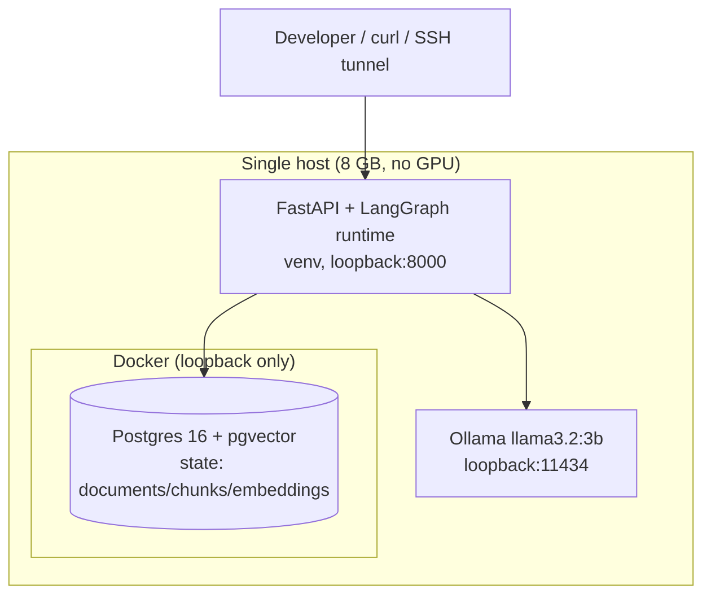
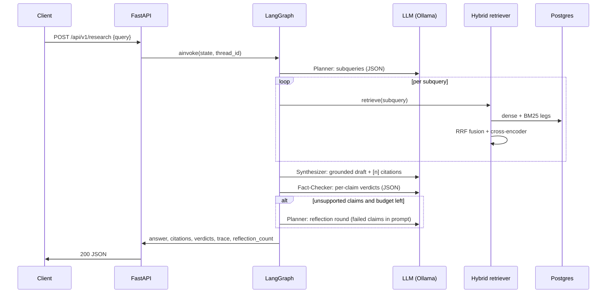

# OmniAgent High-Level Design (HLD)

## 1. System context

OmniAgent answers technical questions from an indexed corpus with cited,
verified answers. Everything runs on one host, self-contained:

External dependencies: none at runtime. Package/model downloads (PyPI, HF Hub,
Ollama registry) happen at setup time only; no user data leaves the host.

## 2. Components and responsibilities

| Component | Responsibility | Failure behavior |
|---|---|---|
| `app/api` | HTTP surface, auth (optional key), metrics, request lifecycle | 503 on LLM outage, 404 unknown ingest path |
| `app/agents` | LangGraph state machine: plan, retrieve, synthesize, verify, finalize | Bounded reflection; refusal on thin evidence |
| `app/retrieval` | Hybrid search: dense + sparse legs, RRF fusion, cross-encoder rerank | Degrades per-stage via flags; empty result -> refusal |
| `app/ingestion` | LlamaIndex parse/split/embed; idempotent persistence | Job row records error; re-run is safe |
| `app/llm` | One OpenAI-compatible client: retries, timeouts, role routing | `LLMUnavailableError` -> HTTP 503 after retries |
| `app/db` | SQLAlchemy async schema + sessions; Alembic migrations | pool_pre_ping; ping in /health |
| `app/eval` | Golden-set ablation + RAG Triad with LLM judges | Reports still written on partial failure |
| `app/observability` | Prometheus metrics from the graph trace | Metrics never block the request path |

## 3. Request lifecycle (happy path)

## 4. Key design decisions (summaries; full ADRs in docs/adr/)

- **Rank-based fusion, not score mixing** (ADR-0001): cosine and BM25 scores are
  different units; RRF fuses ranks only. Rerank applies only to top-N fused
  candidates (cost control).
- **First-party LLM client** (ADR-0002): retries, role routing (fast/strong model),
  timeouts and tolerant JSON parsing are owned code, testable and explainable;
  swapping Ollama -> vLLM -> a commercial API is a `.env` change.
- **LlamaIndex for ingestion, first-party retrieval** (ADR-0003): framework owns
  parsing/splitting/embedding (boilerplate-heavy), we own schema, dedupe, fusion,
  rerank (the parts that must be explainable and ablatable).
- **Bounded reflection** (ADR-0004): the loop is conditional (failed claims AND
  budget), feedback is structured (failed claims + suggested subqueries), and the
  budget guarantees termination.
- **Ollama now, vLLM on GPU later** (ADR-0005): same client contract; the upgrade
  is operational, not architectural.

## 5. Failure modes and degradation

| Failure | Behavior | User-visible |
|---|---|---|
| LLM endpoint down | tenacity retries -> `LLMUnavailableError` | 503 with detail |
| LLM emits unparseable JSON | tolerant parser; planner falls back to raw query; fact-checker treats draft as unsupported (fail-closed) | reflection or flagged claims |
| Evidence below threshold | Synthesizer refuses instead of guessing | `refused: true`, honest message |
| Postgres down | /health reports degraded; requests fail fast | 5xx |
| Corpus empty | BM25 not built; dense empty; refusal path | refusal |

## 6. Scaling path (per axis)

- **Corpus size**: BM25 is in-process today (rebuilt on count change); at ~100k
  chunks move the sparse leg to Postgres `tsvector` behind the same function
  signature; add an HNSW index for the dense leg.
- **Throughput**: run the API behind workers; the checkpointer serializes
  checkpoint writes on one connection today (documented in LLD) -- move to a
  pooled saver per worker.
- **Model quality**: raise `LLM_MODEL`/`LLM_FAST_MODEL` (e.g. 8B) or point
  `LLM_BASE_URL` at vLLM on a GPU host (ADR-0005).
- **Evaluation depth**: golden set grows; judges can be a stronger model; add
  adversarial distractors to expose hybrid recall gains (see EVALUATION.md).
