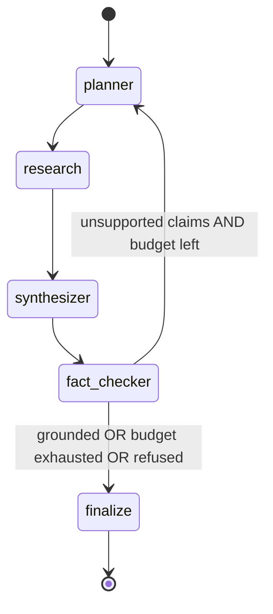
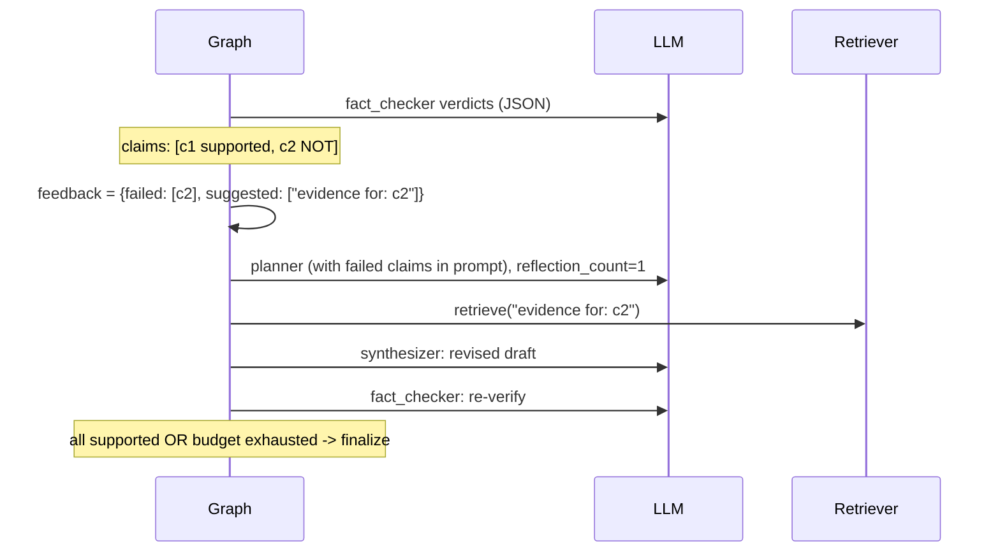

# OmniAgent Low-Level Design (LLD)

Companion to `ARCHITECTURE.md` (HLD). This document is module-level: exact
responsibilities, data model, interfaces, state machine semantics, invariants,
and known limitations with their upgrade paths.

## 1. Module map

```text
app/core/config.py     Settings (pydantic-settings, .env only). URL assembly properties.
app/core/logging.py    structlog: JSON in prod, console in dev.
app/db/models.py       Base, Document, Chunk, IngestionJob (SQLAlchemy 2 typed).
app/db/session.py      lazy async engine + sessionmaker; ping() for /health.
app/llm/client.py      LLMClient, parse_json, LLMResult, LLMUnavailableError.
app/ingestion/         embedder.py (BGE singleton), pipeline.py (idempotent ingest), seed.py (CLI).
app/retrieval/         dense.py, sparse.py (BM25 cache), rrf.py (pure), rerank.py, pipeline.py.
app/agents/            state.py, prompts.py, feedback.py, nodes/*, graph.py, checkpointer.py.
app/api/              app.py (assembly/middleware/lifespan), routes.py (v1).
app/observability/     metrics.py (Prometheus collectors).
app/eval/              runner.py (ablation + triad + report writer).
```

Dependency direction (enforced by convention, no cycles):
`api -> agents -> {llm, retrieval, db} -> {core, db}`, `ingestion -> {llama_index, db}`,
`eval -> {agents, retrieval, llm, db}`. `core` depends on nothing internal.

## 2. Data model

| Table | Key columns | Invariants |
|---|---|---|
| documents | id PK, source_path UNIQUE, title, content_hash, doc_metadata JSONB, created_at | one row per source file; title refreshed on re-ingest |
| chunks | id PK, document_id FK ON DELETE CASCADE, chunk_index, content, content_hash UNIQUE, embedding vector(384) | content_hash UNIQUE = idempotent ingestion; FK keeps chunks consistent with docs |
| ingestion_jobs | id PK, status, documents_seen, chunks_created, chunks_skipped, error, started_at, finished_at | one row per ingest run; failed runs record the error text |
| (LangGraph checkpoints) | framework-owned tables | created by `AsyncPostgresSaver.setup()`; intentionally NOT in our Alembic migrations (separate ownership boundary) |

Migration ownership: Alembic owns documents/chunks/ingestion_jobs
(`alembic/versions/0001_initial.py`, includes `CREATE EXTENSION vector`).
The checkpointer owns its own tables. Never let two owners manage one table.

## 3. Key interfaces

```python
# app/llm/client.py
class LLMClient:
    def model_for(role: Role) -> str                       # "fast" | "strong"
    async def complete(role, system, user, *, json_mode=False,
                       trace=None, node="") -> LLMResult     # retries + timeout + trace entry

def parse_json(text: str) -> dict | list | None             # fence-stripping, first-JSON-value

# app/retrieval/pipeline.py
@dataclass
class Evidence: chunk_id, document_id, content, title, scores: dict

class RetrievalPipeline:
    async def retrieve(query, flags: RetrievalStageFlags | None) -> (list[Evidence], timings)

# app/retrieval/rrf.py  (pure, deterministic)
def fuse(rankings: dict[str, list[str]], k: int = 60) -> list[(id, score)]

# app/agents/graph.py
def build_graph(llm, retriever, *, checkpointer=None,
                max_reflections=None, refusal_min_evidence=None) -> CompiledGraph
```

Every stage of `retrieve()` is independently toggleable (`.env` or explicit
`RetrievalStageFlags`) -- this is what makes the ablation arms exact.

## 4. Agent graph state machine

State (`OmniAgentState`, TypedDict, total=False): `query, subqueries, feedback,
evidence, draft, refused, verdicts, unsupported_claims, reflection_count,
citations, answer, trace, error`.



Node semantics (each returns a partial state update; LangGraph merges):

- **planner**: 1-4 subqueries via the fast model (JSON). Fallback on unparseable
  output: `[original query]` -- the graph always remains runnable. When entering
  from a reflection edge (`feedback.failed_claims` non-empty), the failed claims
  are embedded in the prompt and `reflection_count += 1`.
- **research**: hybrid retrieve per subquery (max 4); merge by chunk_id keeping
  the best per-stage score. Across reflection rounds evidence ACCUMULATES:
  prior evidence keeps its position (citation stability -- the draft's [n]
  citations must keep pointing at the same text after a reflection round) and
  new chunks append after it, capped with per-round slack. Every retrieval
  timing goes into `trace` (no model call).
- **synthesizer**: refusal gate first -- fewer than `REFUSAL_MIN_EVIDENCE`
  chunks means `refused: true` and an honest refusal message, no LLM call.
  Otherwise a grounded draft with `[n]` citations via the strong model.
- **fact_checker**: skipped entirely when refused. Verdicts are strict
  ("supported ONLY if the evidence states it explicitly"). Unparseable verdict
  JSON is **fail-closed**: the whole draft becomes one unsupported claim. This
  can only cause reflection (bounded), never a silent pass.
- **finalize**: answer + citations from the evidence list; unsupported claims
  (if the budget was exhausted) remain visible in the response for honesty.

Termination proof: the only cycle is fact_checker -> planner, and it requires
`reflection_count < max_reflections`; `reflection_count` strictly increases per
traversal, so the graph terminates in at most `1 + max_reflections` rounds
(= 4 nodes per round + finalize; LangGraph's recursion limit 25 is never reached
at defaults).

## 5. Sequence: reflection round (the interesting case)



## 6. Invariants and error taxonomy

Invariants (all unit-tested or structurally guaranteed):

1. Ingestion is idempotent: unique `chunks.content_hash` means a retry can never
   duplicate a chunk.
2. `fuse()` is deterministic: same rankings -> same output order (tie-break by id).
3. The graph terminates within `1 + MAX_REFLECTIONS` rounds (conditional edge +
   monotone reflection_count).
4. Refused answers never contain generated text from the model (refusal path
   skips the synthesizer LLM call).
5. Fail-closed verification: no verdict parse -> treated as unsupported.
6. Citation stability across reflection rounds: prior evidence order is never
   mutated; new evidence only appends (research node).
7. Ingestion converges the index to the directory state: vanished chunks are
   deleted, removed files' documents are dropped (FK cascade).

Error taxonomy (source -> behavior):

- `LLMUnavailableError` (llm/client.py) -> HTTP 503. Raised only after tenacity
  retries (`LLM_MAX_RETRIES`, exponential jitter) are exhausted.
- `APIStatusError` on json_object mode -> one graceful retry without json mode.
- Unparseable node JSON -> per-node fallbacks (planner: raw query; fact-checker:
  fail-closed unsupported).
- `FileNotFoundError` on ingest -> HTTP 404.
- DB down -> `/health` degraded; requests fail fast (engine pool_pre_ping).

## 7. Concurrency model

- The API event loop never blocks on CPU: embedding batches, BM25 scoring and
  cross-encoding run via `asyncio.to_thread` (`app/ingestion/embedder.py`,
  `app/retrieval/rerank.py`).
- Singletons: embedder, reranker, BM25 index, LLM client, compiled graph,
  checkpointer -- created lazily per process, one model load each.
- **Known limitation**: `AsyncPostgresSaver.from_conn_string` owns a single
  psycopg connection; concurrent graph runs serialize their checkpoint writes.
  Upgrade path: a pooled saver per worker process (see ADR-0005 note and
  `app/agents/checkpointer.py` docstring).
- BM25 index rebuild is guarded by a lock; rebuild triggers on chunk-count change
  (cheap staleness heuristic, documented in `app/retrieval/sparse.py`).

## 8. Configuration surface (all `.env`, no code constants)

Core: APP_ENV, LOG_LEVEL. API: API_HOST/API_PORT/API_KEY (optional X-API-Key).
DB: DB_USER/PASSWORD/HOST/PORT/NAME. LLM: LLM_BASE_URL/MODEL/FAST_MODEL/API_KEY/
TIMEOUT_S/MAX_RETRIES. Models: EMBEDDING_MODEL/DIM, RERANKER_MODEL. Ingestion:
CHUNK_SIZE/OVERLAP. Retrieval: RETRIEVAL_TOP_K, FUSION_TOP_N, RRF_K, RERANK_TOP_K,
HYBRID_ENABLED, RERANK_ENABLED. Agents: MAX_REFLECTIONS, REFUSAL_MIN_EVIDENCE.
Eval: EVAL_GOLDEN_PATH. Every knob has a tested default; env vars override the
`.env` file (pydantic-settings precedence).

## 9. Testing strategy

- Unit (19 tests, no backend required; run in CI): RRF math + determinism, BM25
  ranking with a faked store (fixture note: rank_bm25 IDF degenerates at N=2,
  fixtures use 6+ docs), config URL assembly, reflection feedback structure,
  tolerant JSON parsing, and full graph behavior with `FakeLLM`/`FakeRetriever`
  + `MemorySaver`: refusal on thin evidence, no-reflection when all claims pass,
  and bounded termination with a budget of 1.
- Integration (by hand, on the server): migration -> seed (twice) -> live E2E
  query with trace -> ablation -> triad. Results are committed artifacts.

## 10. SSE streaming endpoint (`POST /api/v1/research/stream`)

| event | payload | when |
|---|---|---|
| node | `{node, ...compact payload}` | after each graph node completes (planner subqueries; research evidence count + titles; synthesizer draft preview + refused flag; fact-checker claim summary + will_reflect; finalize answer preview) |
| result | full response contract + `elapsed_ms` | after the run completes (state read via `aget_state`) |
| error | `{detail}` | LLM backend failure after retries (mid-stream: the HTTP status can no longer change) |
| done | `{thread_id}` | always terminal |

Implementation: `graph.astream(..., stream_mode="updates")` yields per-node
updates; a final `aget_state` supplies the full state for `result`. Rationale
and the token-level upgrade path: ADR-0006.

## 11. Ingestion convergence (deletion sync)

Re-ingesting a directory converges the index to that directory's current
state: (a) per re-seen source, chunks whose content_hash no longer appears in
the file are deleted; (b) documents under the directory that were not seen in
the run are deleted (FK ON DELETE CASCADE removes their chunks). The summary
reports chunks_created / chunks_skipped / chunks_deleted / documents_removed.
Verified live: edit + delete + add re-ingest -> {created 2, skipped 1,
chunks_deleted 1, documents_removed 1}; the next run was a pure no-op.
